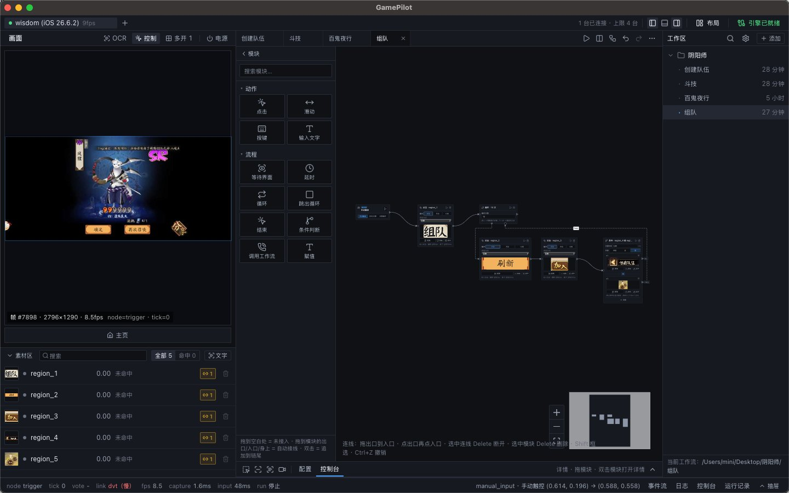

# GamePilot

GamePilot 是一款面向游戏的状态机式自动化工作台：框选界面即可识别，拖拽连线即成脚本，
一台电脑同时驱动 Android、iPhone 与本机窗口。

## 功能

- **[画面识别](./docs/USAGE.md#判断条件与基础操作)**：模板匹配、颜色识别、OCR；框选即建识别器，命中后按模板当前位置点击。
- **[状态机脚本](./docs/USAGE.md#图编辑器)**：节点是界面，边是动作；恢复边优先，弹窗可打断；运行中热重载。
- **[录制](./docs/USAGE.md#录脚本把操作直接录成步骤)**：点击、长按、滑动直接录；滑动分点对点与连续，连续录制按住 <kbd>Shift</kbd> 锁成起止直线。
- **[拟人执行](./docs/USAGE.md#滑动点对点--连续顶部选择框切换)**：轨迹、时长、末端按住与抖动，可全局或按步骤调。
- **[多设备](./docs/USAGE.md#怎么用三步)**：Android、iOS 17.4+、macOS 窗口；多开网格、独立窗口、布局记忆。
- **本地运行**：截图、识别、执行都在本机，画面不上传。

## 文档

| 文档 | 内容 |
|---|---|
| [使用与开发](./docs/USAGE.md) | 环境要求、启动、设备连接、工作流编辑、发布打包、提交前检查 |
| [总体设计](./docs/DESIGN.md) | 数据模型、UI、里程碑 |
| [项目规范](./docs/CONVENTIONS.md) | 依赖方向、命名、坐标、测试、DoD |
| [RPC 契约](./docs/rpc.md) | 前端 ⇄ 引擎 |
| [ADR](./docs/adr/) | 重大决策记录 |
