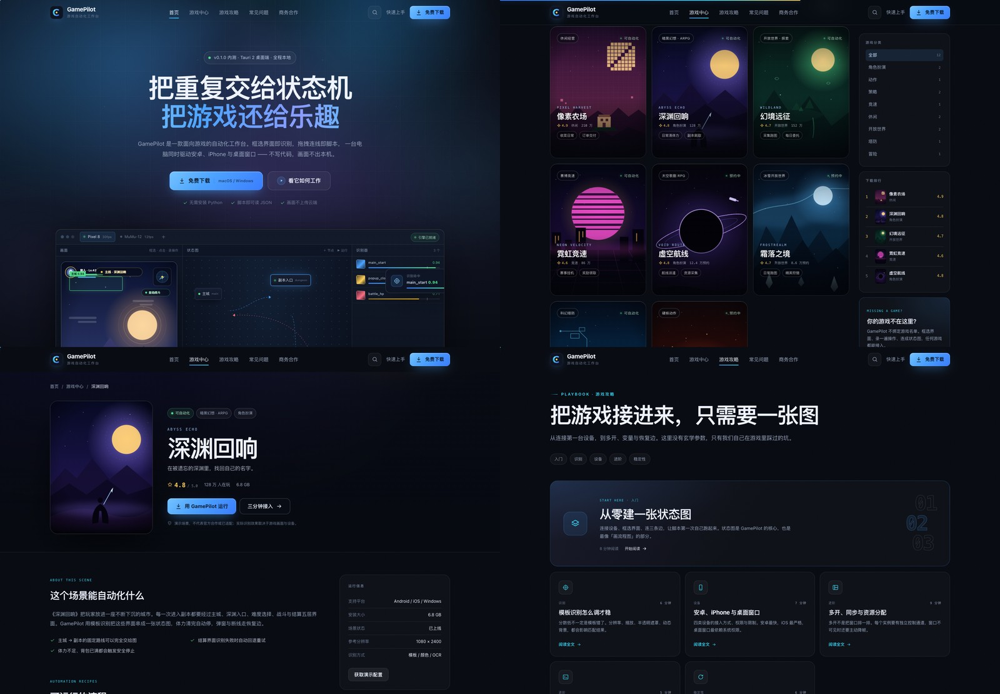

# GamePilot 官网与游戏中心（独立前端站点）



GamePilot 的产品官网与游戏中心，与同仓库的 Tauri 桌面端完全分离：本目录有独立的
`package.json`，不在根目录的 `pnpm-workspace.yaml`（只包含 `apps/*`、`packages/*`）中，
也不参与桌面端构建。

站点是**多页面应用**：首页负责产品叙事，游戏中心是独立的可浏览、可搜索、可分页的游戏库，
每个游戏有详情页，攻略、FAQ、商务合作与下载也都是独立路由。

## 路由

| 路径 | 页面 |
| --- | --- |
| `/` | 首页：产品 hero、状态机能力、工作流、设备矩阵、对比、FAQ |
| `/games` | 游戏中心：焦点轮播、热门推荐、新游预约、分类、排行、搜索、分页 |
| `/games/:slug` | 游戏详情：封面、简介、自动化流程、识别示意、运行信息、相关场景 |
| `/guides` | 攻略列表 |
| `/guides/:slug` | 攻略文章（目录、正文、上一篇/下一篇） |
| `/faq` | 常见问题 |
| `/business` | 商务合作与需求表单（前端演示） |
| `/download` | 下载页：平台切换、系统要求、版本内容 |
| `*` | 404 |

`/games` 的筛选状态全部保存在 URL 里，可以直接分享或刷新：

- `?q=塔防` 关键词搜索
- `?category=角色扮演` 分类筛选
- `?sort=rating` 排序（`popular` / `rating` / `az`）
- `?page=2` 分页（每页 8 款）
- `?focus=search` 从头部搜索图标进入时自动聚焦搜索框

## 游戏库

`src/data/games.js` 包含 12 款原创演示游戏（6 款可自动化 + 6 款预约中），字段包括标题、
分类、评分、热度、平台、标签、自动化配置、三条可运行场景与识别参数。游戏中心的焦点轮播、
热门推荐、下载排行、新游预约、分类计数、详情页和相关推荐都从这份数据派生。

封面是 `src/components/GamePoster.jsx` 里的 12 组内联 SVG（暗黑、霓虹、太空、浮空岛、
王冠、像素、冰原、余烬、潮汐、虚空、沙漠、花町），没有使用任何第三方游戏素材。

### 替换成自己的封面

如果你有已授权的官方素材，把图片放进 `public/covers/`，然后在 `src/data/games.js` 对应
游戏上加一个 `cover` 字段即可，其他布局无需改动：

```js
{
  slug: 'abyss-echo',
  // ...
  cover: 'covers/abyss-echo.jpg'
}
```

`GamePoster` 会优先渲染 `cover`，并自动拼接 Vite 的 `BASE_URL`。海报建议使用 400 × 520
（或同比例）的竖图；详情页的大图与游戏卡会按 `object-fit: cover` 裁切。

> 站点没有直接搬用 NoxPlayer 等产品的封面素材。那些图片受版权保护，且“支持名单”需要真实
> 适配与授权；这里用原创场景占位，并保留了一条可替换素材的路径。

## 技术栈

- Vite 8 + React 19
- React Router 7（`BrowserRouter`）
- Motion（`motion/react`）负责入场、滚动揭示与微交互
- Lenis 负责平滑滚动与锚点跳转
- 无 UI 框架、无 Tailwind、无外部字体/图片/CDN；所有视觉素材为内联 SVG 或 CSS 绘制

## ReactBits 组件

`src/reactbits/` 下是 [ReactBits](https://reactbits.dev/) 组件，按原版行为移植为无 Tailwind 版本：

| 组件 | 用途 |
| --- | --- |
| `TechText` | 首页引擎区全宽 `GAMEPILOT` 虚线蓝图字；鼠标透镜揭示填充、自动扫光、字母可拖拽/点击 |
| `TiltedCard` | 游戏海报卡的 3D 倾斜、视差与 glare（首页、游戏中心、新游预约） |
| `BlurText` | 章节标题逐字模糊浮现 |
| `SpotlightCard` | 功能卡片跟随鼠标的径向高光 |
| `CountUp` | 首屏数据滚动计数 |
| `GlareHover` | 代码面板扫光 |
| `StarBorder` | 底部 CTA 旋转描边 |
| `ClickSpark` | 全站点按火花 |
| `Magnetic` | 主按钮磁吸 |

`TechText`、`TiltedCard` 保留原版权头与实现；其余为去除 Tailwind 依赖后的等价改写。
`TechText` 的移动端提示会自动切换为“触摸字母 · 拖拽试试”。

## 本地运行

```bash
cd site
npm install
npm run dev      # http://127.0.0.1:4173
```

生产构建与本地预览：

```bash
npm run build    # 输出到 site/dist
npm run preview  # http://127.0.0.1:4173
```

## 部署

站点使用真实路径（`BrowserRouter`），部署时需要把未知路径回退到 `index.html`：

- Nginx：`try_files $uri $uri/ /index.html;`
- Vercel / Netlify / Cloudflare Pages：开启 SPA fallback
- 本地静态服务器：不要直接 `python -m http.server dist` 访问 `/games/xxx`，会 404

`vite.config.js` 使用默认的根路径 `base: '/'`。如果部署在子路径下，需要同时设置 Vite 的
`base` 与 `BrowserRouter` 的 `basename`。

## 目录

```
site/
├─ index.html
├─ vite.config.js
├─ public/covers/      自有封面素材（可选）
├─ src/
│  ├─ main.jsx / App.jsx / Layout.jsx
│  ├─ pages/           首页、游戏中心、详情、攻略、FAQ、商务、下载、404
│  ├─ components/      页面分区、游戏卡、海报、分页、页头等 UI
│  ├─ data/            games.js / guides.js / faqs.js
│  ├─ reactbits/       ReactBits 组件
│  ├─ context/         DownloadContext（全局下载弹窗）
│  ├─ hooks/           usePageMeta
│  ├─ styles/          base.css + enhancements.css + pages.css
│  └─ assets/img/      favicon、设备画面 SVG
└─ dist/               npm run build 产物
```

## 说明

- 12 款游戏为原创视觉演示场景，不代表官方合作或已适配名单；真实识别效果取决于游戏画面。
- 站点不包含真实安装包下载、账号或支付能力；按钮与表单均明确标注为演示。
- 商务表单与内测邮箱表单只在前端生效，不会上传或发送任何数据。
- 更新依赖后请重新执行 `npm run build` 验证。
